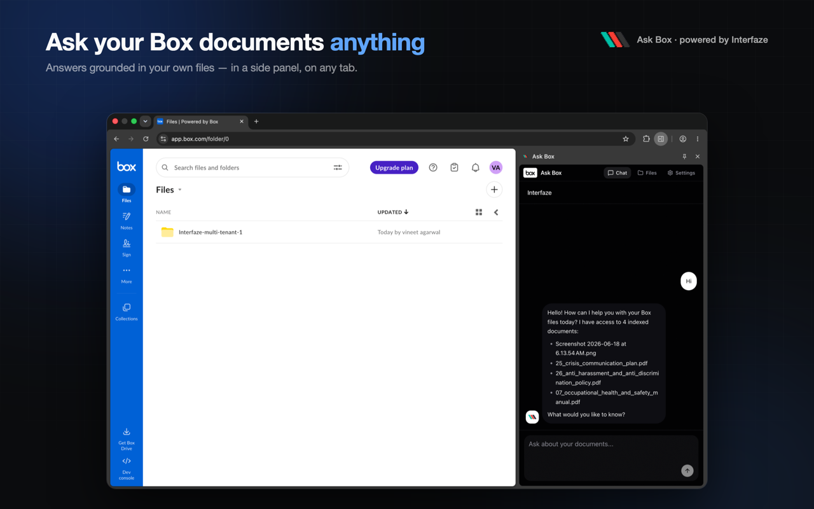

# 📦 Box Demo

A Next.js chatbot that syncs documents from [Box](https://box.com) and gives you grounded, cited Q&A over them — powered by Interfaze OCR, JigsawStack embeddings, and Upstash Vector.

[Interfaze](https://interfaze.ai) · [Interfaze Docs](https://docs.interfaze.ai) · [JigsawStack](https://jigsawstack.com) · [Dashboard](https://jigsawstack.com) · [Chrome Extension](#-chrome-extension--ask-box)

<!-- Add a screenshot or demo GIF at ./public/screenshot.png (the extension store frames in
     extension/store/screenshot-*.png are good candidates, or capture the main app UI). -->


Drop a file into your Box account and watch it flow — automatically — through OCR, chunking, embedding, and indexing, with the UI updating live at every step. Then ask questions and get answers grounded in your own documents, streamed token by token.

Most "chat with your docs" demos make you manually upload files. This one wires directly into Box: the moment a file lands in your account, a webhook kicks off the pipeline and the document becomes searchable — no manual import step.

## ✨ Key Features

- 📤 **Zero-touch sync** — a Box `FILE.UPLOADED` webhook starts indexing automatically; no manual upload
- 🔍 **OCR extraction** — [Interfaze](https://interfaze.ai) pulls text from PDFs, scans, and images
- 🧠 **Semantic search** — [JigsawStack](https://jigsawstack.com) embeddings + [Upstash Vector](https://upstash.com) for top-k retrieval
- 💬 **Grounded chat** — answers cited to your documents, streamed to the browser over SSE
- ⚡ **Live status** — `Queued → Extracting → Embedding → Indexed`, pushed to the UI via Redis pub/sub
- 🧩 **Chrome extension** — chat with your indexed Box docs from any tab (side panel)
- 🔒 **Per-account isolation** — anonymous sessions keep each user's documents separate
- 🚀 **One-click deploy** — ships to Vercel out of the box

Powered by [Interfaze](https://interfaze.ai) and [JigsawStack](https://jigsawstack.com).

## 🏗️ Architecture

```
Box File Upload
    ↓
[FILE.UPLOADED webhook] → QStash Queue
    ↓
[POST /api/process] (async job)
    ├─ Interfaze: OCR extract text
    ├─ Chunk text into segments
    ├─ JigsawStack: embed each chunk (768 or 4096 dims)
    └─ Upstash Vector: upsert indexed chunks (idempotent)
    ↓
Live UI: File status Queued → Extracting → Embedding → Indexed
    ↓
Chat: User question
    ├─ JigsawStack: embed question
    ├─ Upstash Vector: semantic search (top 6 chunks)
    ├─ OpenAI via Interfaze: generate grounded answer
    └─ SSE stream to browser
```

## 🚀 Quick Start

### 1. Clone & Install

```bash
git clone https://github.com/InterfazeAI/box-demo.git
cd box-demo
npm install
```

### 2. Create `.env.local`

Copy the template and fill in all values:

```bash
cp .env.example .env.local
```

**Required environment variables** (see `.env.example`):
- `APP_URL` — public URL for webhook callbacks (see "Public URL" below)
- `BOX_CLIENT_ID`, `BOX_CLIENT_SECRET` — from Box app
- `BOX_REDIRECT_URI` — set by Next.js; typically `${APP_URL}/api/box/oauth/callback`
- `BOX_WEBHOOK_PRIMARY_KEY`, `BOX_WEBHOOK_SECONDARY_KEY` — Box webhook signature keys
- `INTERFAZE_API_KEY`, `INTERFAZE_BASE_URL` — Interfaze OCR service
- `JIGSAWSTACK_API_KEY` — JigsawStack embeddings
- `UPSTASH_VECTOR_REST_URL`, `UPSTASH_VECTOR_REST_TOKEN` — Upstash Vector index
- `UPSTASH_REDIS_REST_URL`, `UPSTASH_REDIS_REST_TOKEN` — Upstash Redis (status pub/sub)
- `QSTASH_TOKEN`, `QSTASH_CURRENT_SIGNING_KEY`, `QSTASH_NEXT_SIGNING_KEY` — Upstash QStash

### 3. Upstash Setup

#### Vector Index (Critical: dimension must match your JigsawStack embedding size)

1. Go to [upstash.com](https://upstash.com) → create a **Vector** index
2. **Before creating the index**, determine your embedding dimension:
   - Run this snippet in your project (after setting `JIGSAWSTACK_API_KEY` in `.env.local`):
     ```ts
     import { embed } from "@/lib/jigsawstack";
     console.log((await embed("test")).length); // <- this is your dimension
     ```
   - **JigsawStack v1 = 768 dims**, **v2 = 4096 dims** (per task brief, assume 4096 unless you verified otherwise)
3. Create the Vector index with **exactly** that dimension (e.g., 4096)
4. Copy `UPSTASH_VECTOR_REST_URL` and `UPSTASH_VECTOR_REST_TOKEN` to `.env.local`

#### Redis Database

1. In Upstash → create a **Redis** database
2. Copy `UPSTASH_REDIS_REST_URL` and `UPSTASH_REDIS_REST_TOKEN` to `.env.local`

#### QStash

1. In Upstash → create a **QStash** instance
2. Copy `QSTASH_TOKEN`, `QSTASH_CURRENT_SIGNING_KEY`, and `QSTASH_NEXT_SIGNING_KEY` to `.env.local`

### 4. Box App Setup

1. Go to [developer.box.com](https://developer.box.com)
2. Create a new app with **OAuth 2.0 (user auth)**
3. Set redirect URI to: `${APP_URL}/api/box/oauth/callback` (e.g., `https://example-tunnel.ngrok.io/api/box/oauth/callback`)
4. Copy **Client ID** and **Client Secret** to `.env.local`
5. Set up a **webhook** for file uploads:
   - In your Box app settings → Webhooks → add a webhook pointing to `${APP_URL}/api/box/webhook`
   - Event: `FILE.UPLOADED`
   - Copy the **Primary** and **Secondary** signature keys to `BOX_WEBHOOK_PRIMARY_KEY` and `BOX_WEBHOOK_SECONDARY_KEY` in `.env.local`

### 5. Public URL (Local Dev or Deployed)

Box webhooks and QStash callbacks require a public URL.

#### Option A: Local Development (Tunnel)

Use ngrok or similar to expose localhost:3000:

```bash
ngrok http 3000
```

Copy the tunnel URL (e.g., `https://abc123-tunnel.ngrok.io`) and set:

```bash
APP_URL=https://abc123-tunnel.ngrok.io
```

#### Option B: Deploy to Vercel

```bash
vercel deploy
```

Then set:

```bash
APP_URL=https://your-project.vercel.app
```

### 6. Build Prerequisites

All environment variables must be set **before** running `npm run build` or `npm run dev`, because client modules (e.g., `lib/jigsawstack.ts`) read env vars at import time. A build with missing keys will fail at startup.

## 🏃 Run

```bash
npm run dev
```

Navigate to `http://localhost:3000`.

## ☁️ One-Click Deploy

Deploy your own instance to Vercel:

[](https://vercel.com/new/clone?repository-url=https%3A%2F%2Fgithub.com%2FInterfazeAI%2Fbox-demo&env=APP_URL,BOX_CLIENT_ID,BOX_CLIENT_SECRET,BOX_WEBHOOK_PRIMARY_KEY,BOX_WEBHOOK_SECONDARY_KEY,INTERFAZE_API_KEY,INTERFAZE_BASE_URL,JIGSAWSTACK_API_KEY,UPSTASH_VECTOR_REST_URL,UPSTASH_VECTOR_REST_TOKEN,UPSTASH_REDIS_REST_URL,UPSTASH_REDIS_REST_TOKEN,QSTASH_TOKEN,QSTASH_CURRENT_SIGNING_KEY,QSTASH_NEXT_SIGNING_KEY,SESSION_SECRET)

After deploying, set `APP_URL` to your Vercel URL and point your Box webhook + redirect URI at it.

## 🎮 Demo Flow

1. **Click "Connect Box"** in the top-right
   - You'll be redirected to Box login and asked to authorize the app
   - After successful OAuth, the app stores your tokens in Redis

2. **Upload a file to your Box account**
   - The Box webhook triggers → sends to QStash → async job starts
   - Watch the **Files** panel on the left as the status changes:
     - Queued → Extracting (Interfaze OCR)
     - → Embedding (JigsawStack)
     - → Indexed (in Upstash Vector)

3. **Ask a question in the Chat panel**
   - The app embeds your question, searches the Vector index for relevant chunks, and streams a grounded answer from OpenAI via Interfaze

4. **Try uploading multiple files** to see them all indexed and searchable together in one session

## 🧪 Testing

Run all unit tests (chunk extraction, Redis status, Box signature validation, JigsawStack embedding parsing, context building):

```bash
npm run test
```

Watch mode:

```bash
npm run test:watch
```

## 📝 Notes

- **Interfaze model IDs** (`interfaze-ocr` in `lib/interfaze.ts` and `interfaze` in `app/api/chat/route.ts`) are placeholders. Verify against current [Interfaze docs](https://docs.interfaze.ai) before relying on them in production.
- **Dimension mismatch error**: If you see a Vector dimension error, you likely created your Upstash Vector index at the wrong dimension. Run the snippet above to confirm your embedding size and recreate the index at the correct dimension.
- **Webhook delivery**: Box webhooks may take a few seconds to deliver. If a file doesn't appear in the UI, check the QStash or Redis logs.

## 🔧 Troubleshooting

- **"Build failed: Cannot find module '@/lib/jigsawstack'"**: Set all env vars in `.env.local` before building.
- **"403 - bad signature" on webhook**: Verify `BOX_WEBHOOK_PRIMARY_KEY` and `BOX_WEBHOOK_SECONDARY_KEY` match your Box app settings.
- **"Vector dimension mismatch"**: Run the embedding size check above and recreate your Upstash Vector index at the correct dimension.

## 🧱 Stack

- **Next.js 15** — React framework
- **Box SDK** — file management & webhooks
- **Interfaze** — OCR text extraction & chat
- **JigsawStack** — embeddings
- **Upstash Vector** — semantic search index
- **Upstash Redis** — status pub/sub
- **Upstash QStash** — async job queue
- **Vercel AI SDK** — streaming chat responses
- **Tailwind** — UI styling

## 🧩 Chrome Extension — Ask Box

A Chrome side-panel extension to chat with your indexed Box documents from any
tab. It reuses this app's `/api/chat` backend and chat UI.

### Build & load

```bash
# from the repo root (ensures runtime deps are installed)
npm install

cd extension
npm install
npm run build        # outputs extension/dist/
# or: npm run dev    # watch mode, rebuilds on change
```

1. Open `chrome://extensions`, enable **Developer mode**.
2. Click **Load unpacked** and select `extension/dist/`.
3. Click the **Ask Box** toolbar icon to open the side panel.
4. Click the gear icon and set the **Backend URL** (default `http://localhost:3000`),
   then Save.
5. Ask questions about your indexed Box documents.

Requires Chrome 114+ (Side Panel API). The backend URL is stored in
`chrome.storage.sync`; switch it any time to point at a deployed instance.

## 📄 License

Released under the [MIT License](./LICENSE).
